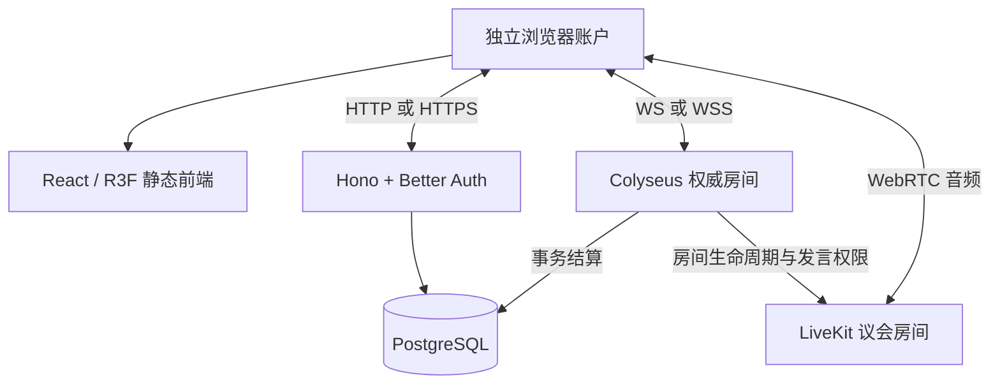

# 《亡絮：归灯》Soulwisp: Returnlight · 实现架构与单机迁移

2026-10-10 · 四人优先；本地逐档完成并验收 4–10 人后统一上云。

当前工程采用 **React 19、Three.js、React Three Fiber 9 / drei、Vite、Node 24、Colyseus、Hono、Better Auth、Drizzle / PostgreSQL 15 与自建 LiveKit**。免费 KayKit GLB 直接在固定正交镜头下实时渲染；权威规则在二维平面计算。单台 VPS 可提供静态前端、API、房间、数据库和议会语音；Cloudflare Pages 保留为之后可选的静态托管。

## 已实现的模块

| 路径 | 责任 |
| --- | --- |
| `apps/web` | 三维场景、中文 DOM 界面、六阶段训练、营地、房间与议会语音 |
| `apps/server` | Hono / Better Auth 账户、Colyseus 权威房间、结算和 LiveKit 权限 |
| `apps/server/src/db`、`migrations` | PostgreSQL schema、启动迁移、营地 / 请求 / 结算 / 实物兑换约束 |
| `packages/rules` | 人数配置、地图、动作、证据、章节、投票、终局与奖励 |
| `packages/shared` | 命令、按玩家授权的视图、营地和结算协议 |
| `deploy` | 单台 Linux VPS 模板、HTTPS / TURN 分流、每日备份与恢复 |

服务端通过Colyseus原生`setFixedTimestep(..., 20)`累计实际时间，运行20 Hz模拟、10 Hz推送。客户端发送移动、技能、交互、交易、投票等意图；距离、碰撞、冷却、阶段、归属和终局由服务器裁定。每人获得自己的 `viewFor(userId)`：局部坐标和目击按视野过滤，真实身份仅私发本人，狼队信息仅给未封印狼人，完整阵营终局才公布。共享规则代码不包含运行时随机身份或完整秘密房间状态。

命中、受击、盾挡、推挤、碰撞和交互完成由服务器回传带序号的本人事件；客户端据此播放音效、触感、短停顿和粒子。重连不重播过期事件，设备不支持震动时继续提供视听反馈。音量、静音与减少动态效果可在对局设置调整。

## 本机与局域网

首次准备使用 Node 24、PostgreSQL 15 命令行工具；Apple Silicon 原生 LiveKit 安装还使用 Go。依次执行 `npm ci`、`npm run setup`、`node scripts/install-services.mjs`，日常入口为 `npm run dev`。详见 [本地开发](local-development.md)。

| 服务 | 本机地址 / 数据位置 |
| --- | --- |
| 前端 | `http://localhost:5180`，可用 `WEB_PORT`调整；同源 `/api` 经 Vite 代理 |
| API | `http://127.0.0.1:3000`；`/api/health` 检查真实数据库 |
| 房间 | `ws://localhost:2567`；同端口处理入房 HTTP |
| PostgreSQL | `127.0.0.1:55432`；独立 `.local/postgres` |
| LiveKit | 内部 `http://127.0.0.1:7880`，浏览器 `ws://localhost:7880` |

普通标签页共享 cookie。多玩家测试使用独立浏览器上下文 / 配置或不同设备。营地库存、研究、外观、当前配装和最多五套配装预设来自 PostgreSQL，服务重启后仍可读取。

同 Wi-Fi 执行 `node scripts/lan.mjs 192.168.x.x`，生成内网 Caddy HTTPS 并更新允许来源、WSS 和 LiveKit LAN 候选地址；重启应用。前端 / 游戏 / 语音分别经过 8443 / 8444 / 8445。每台设备安装并信任 `.local/caddy/pki/authorities/local/root.crt`，允许麦克风。本机 localhost 有安全上下文例外，普通 LAN IP 的 HTTP 页面需要可信 HTTPS 才能使用麦克风。[Caddy 本地证书](https://caddyserver.com/docs/automatic-https#local-https)、[媒体 API](https://www.w3.org/TR/mediacapture-streams/#navigator-interface)

LAN LiveKit 使用 `node_ip: 电脑LAN地址`、`use_external_ip: false`；设备到电脑放行 UDP 50000–50100、TCP 7881。目标 Wi-Fi 仍需检查设备隔离和真实手机互听，数据库不向玩家开放。

## 持久账户与事务

Better Auth 将 user / session / account / verification 映射到 PostgreSQL，邮箱密码认证启用数据库事务。营地写接口验证 session、JSON 与允许来源；浏览器通过同源 `/api` 携 cookie 请求。入房票据 HMAC 签名、有效 60 秒，房间绑定账户并禁止同一账户同时占多个席位。

| API | 行为 |
| --- | --- |
| `/api/auth/*` | 注册、登录、会话、登出 |
| `GET /api/camp` | 营地材料、外观、研究、配装、预设、教程 |
| `POST /api/craft` | 配方与 requestId；锁定营地，付料 / 解锁原子提交 |
| `POST /api/loadout` | 已拥有外观与合法形态；标准局两形态均可试用 |
| `POST /api/presets` | 预设数组与 requestId；整体替换最多五套，名称1–24字符，验证外观归属 / 职业 / 形态 |
| `POST /api/tutorial` | 六步顺序进度；完成赠外观，不发币 |
| `POST /api/game-ticket` | 短期入房票据与账户 ID |
| `POST /api/voice/token` | 当前议会成员获取本轮 epoch 票据 |

结算由权威房间提交。`matchId` 唯一，整局所有人的奖励同事务写入；相同结算重试返回原奖励，内容不一致拒绝。结算同时保存规则版本、实际人数和地图 uint32 种子；种子用于复现地图，不包含身份随机数。既有记录的种子允许为空。物品 `lootId` 保持单一归属和一次兑换；同局重复持有也拒绝。制作 / 教程 / 预设共用 `(userId, requestId)` 幂等空间，编号不能用于不同 payload。

启动迁移在 PostgreSQL advisory lock 和事务中执行已提交 SQL，记录迁移哈希；已执行文件变更则拒绝继续。新营地零材料、基础外观；无效局不加币、场次或胜场。

## 议会语音与失败处理

语音只在 `DISCUSS` 开放。每章创建随机 epoch 和独立 SFU 房间，`room.auto_create: false`。所有 token 从禁发开始；服务器每 500ms 核对实际参与者，先撤销旧发言权再用 `UpdateParticipant` 授权当前人。自由讨论允许活人发麦，回响一直可听但不能发。视频、屏幕分享和数据发布不授权。

离开议会时服务器删除整个房间。关闭失败暂缓阶段转换，超过 5 秒判无效并继续重试，不继续发牌 / 探索。未过期旧 token 不能重建被删除的房间；客户端静音不是阶段权限依据。[RoomService](https://docs.livekit.io/reference/other/roomservice-api/)、[token 权限](https://docs.livekit.io/frontends/reference/tokens-grants/)

服务停止时拒绝新语音票据，等待正在创建 / 同步的房间，再关闭本实例的房间并重试未完成删除；持续失败记录具体房名。每个房间 metadata 标识创建实例，清理只操作本实例追踪的房名。

单个 LiveKit 实例不要求 Redis；需要分布式房间路由时再引入。[官方分布式说明](https://docs.livekit.io/transport/self-hosting/distributed/)

短断线保留身份、停止输入并允许 60 秒重连；投票开始冻结资格，瞬断不降低门槛。超时判无效，不能把离开的狼当作被封印。终局还有短断线玩家时等待恢复 / 超时后结算。

进行中房间保存在单个 Node 进程内，当前没有服务重启后恢复对局的 checkpoint。重启后重新开局，持久账户和已提交结算保留；维护应等现有局结束。数据库暂时故障时结算重试，尚未入库不能重开。

Compose 等数据库健康；应用先迁移、再监听和通过 readiness。进程退出由 `restart: unless-stopped` 处理；仅 unhealthy 不自动重启，需要检查故障后明确恢复。[Docker 启动顺序](https://docs.docker.com/compose/how-tos/startup-order/)

## 本地全人数到单台 VPS

1. 四人先完整验证训练、秘密权限、各胜负路径、营地、重连与议会语音。
2. 逐档完成并验收 5 / 6 / 7 / 8 / 9 / 10 人的身份、职业、章数、地图、资源、遗票与封印。参数来源为运行配置；自动化验证功能，真人轮换验证社会推理体验。
3. 本地一个十人房：十个独立账户完整打完，同时接议会音频，记录 tick 漂移、CPU / 内存、发送量、重连和音频断流，只测实际首发规模。
4. 所有档本地通过后，按 [部署说明](../deploy/README.md) 迁移选定 VPS。先等活动对局结算、备份，恢复新空库，核对账户 / 营地 / 奖励 / 实物兑换，再切换域名。
5. 公网复测单房十人、两种真实网络、UDP 受限时 TURN/TLS，以及各档入房和结算。

默认 Linux VPS 同机部署静态前端、Node、PostgreSQL、LiveKit。Caddy 自动 HTTPS；game / voice 子域提供 WSS，turn 子域走公网 TCP443。Caddy L4 listener wrapper只截获TURN，解TLS后至内部5349；其他连接由同监听器的HTTP/TLS处理，保留客户端地址。LiveKit另开放UDP媒体、TURN/UDP与直接ICE/TCP；应用私有桥`wangxu0`可访问宿主LiveKit API，公网禁止7880与5349。数据库只在容器内部。[官方端口](https://docs.livekit.io/transport/self-hosting/ports-firewall/)

模板包含每日 PostgreSQL custom dump、保留七份和空库恢复。备份覆盖账户预设与结算地图种子 / 人数，迁移时比较实际记录和营地余额。密码、AUTH_SECRET、LiveKit secret 仅在服务端环境与私有配置，不加 `VITE_` 前缀，也不进入镜像前端构建。

Pages 之后可单独托管 `apps/web/dist`，不承载 Node 房间、数据库或音频。当前默认同源 API；改 Pages 跨域托管需新增 CORS / cookie 域策略、重建公开 HTTPS / WSS 地址并重验登录。[Pages React](https://developers.cloudflare.com/pages/framework-guides/deploy-a-react-site/)

正式入口为[亡絮：归灯](https://gaming.byron.wang)，运行于2核 / 8GB Ubuntu24.04单台VPS。2026-10-10已实测生产Docker构建与启动、四域HTTPS、同源Secure / HttpOnly登录cookie和真实Colyseus WSS入房。完整数据库先恢复到空目标，再按UTC / C排序核对十张表，行数与内容摘要全部一致；每日备份也已恢复到独立空库并导出本机。

公网LiveKit测试使用十个独立音频客户端，强制选择TCP443的TURN/TLS relay。两轮发言切换中，每轮其余九个接收者均收到实际RTP音频；服务器同时核实仅当前发言人可发布。另在正常时长十人远征的第二章议会，使用游戏API签发的真实票据接入十个音频客户端，验证两次发言轮换与九人接收音频。议会结束后全部连接断开、SFU房间删除；结束前签发且仍未过期的旧票据被拒绝，不能重建房间。

最后一版应用容器替换后readiness恢复，再通过登录和WSS检查；随后保持服务稳定完成七档正常时长对局、49个账户真实结算和重新登录持久化。逐档大厅同时验证职业席位、地图节点和未授权入房拒绝。版本、时间、表摘要与relay候选记录见[公网部署验收](verification/deployment-public.json)；服务器七房并发采样见[运行记录](verification/server-runtime.json)，完整阶段与结算见[开发状态](development-status.md)。
