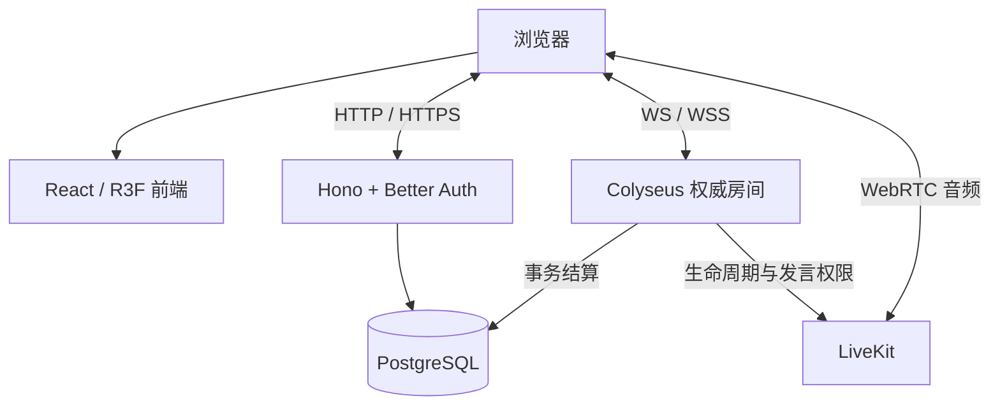

# 实现架构

React 19、Three.js / R3F / drei 与 Vite 提供三维场景和中文界面；Node.js 24 上的 Hono / Better Auth、Colyseus、Drizzle / PostgreSQL 与 LiveKit 提供账户、权威房间、持久化和语音。依赖版本由 [锁文件](../package-lock.json) 固定。

## 模块与数据流

| 路径 | 职责 |
| --- | --- |
| `apps/web` | 场景、训练、营地、房间、设置与语音界面 |
| `apps/server/src/api.ts`、`accounts.ts` | 账户 API、入房票据、库存与事务结算 |
| `apps/server/src/rooms.ts` | Colyseus 房间、授权视图、重连、阶段与结算协调 |
| `apps/server/src/voice.ts`、`voice-lobby.ts` | 议会权限与等待区语音 |
| `apps/server/src/db`、`migrations` | PostgreSQL schema 与启动迁移 |
| `packages/rules` | 人数配置、地图、动作、证据、阶段、终局、奖励与训练 |
| `packages/shared` | 命令、授权视图、营地协议与场景尺寸 |
| `deploy` | 单台 Linux VPS、HTTPS / WSS、TURN、发布、备份与恢复 |

## 服务端权威与授权视图

房间通过 `setFixedTimestep(..., 20)` 运行 20 Hz 模拟，每两个 tick 推送一次视图。客户端发送移动、技能、交互、交易和投票意图；服务器校验距离、碰撞、冷却、阶段、归属和终局。

`viewFor(userId)` 按玩家生成视图：坐标与目击受视野过滤，身份仅发本人，狼队实时信息仅发未封印蚀月者，完整阵营在终局公开。客户端模型、交互目标与反馈跟随授权视图；场景尺寸由 `packages/shared/src/scene.ts` 共用。具体规则见 [运行规则](game-design.md)，渲染与输入见 [场景与界面](presentation.md)。

## 账户、票据与事务

浏览器通过同源 `/api` 携 cookie 请求；写接口校验会话、输入与允许来源。入房票据 HMAC 签名，有效 60 秒，同一账户只允许一个远征席位。

| API | 用途 |
| --- | --- |
| `/api/auth/*` | 注册、登录、会话与登出 |
| `GET /api/camp`、`POST /api/profile` | 营地数据与账户资料 |
| `POST /api/craft`、`/api/loadout`、`/api/presets` | 制作、配装与最多五套账户预设 |
| `POST /api/tutorial` | 六课顺序进度与一次性完成奖励 |
| `POST /api/game-ticket` | 账户绑定的入房票据 |
| `POST /api/voice/token` | 当前议会成员的 epoch 票据 |
| `GET /api/lobby`、`POST /api/lobby/join` | 公共状态摘要、唯一等待区账户席位；准备、偏好和本局席位通过授权 Colyseus 连接同步 |
| `GET /api/voice/lobby`、`POST /api/voice/lobby/token` | [公共大厅](voice-lobby.md) 状态与入场票据 |

制作扣料与解锁原子提交；制作、教程、预设共用 `(userId, requestId)` 幂等空间，同编号不能提交不同内容。`matchId` 唯一，整局奖励同事务写入；相同结算重试返回原结果，内容冲突拒绝。物品 `lootId` 只允许一次兑换。结算保存规则版本、人数和地图种子；地图种子不包含身份随机熵。

启动迁移在 PostgreSQL advisory lock 与事务中执行提交的 SQL，并记录哈希。已应用文件被修改时拒绝启动；新增变更应另建迁移。

## 议会语音与故障处理

远征语音只在 `DISCUSS` 开放，每章使用独立房间与随机 epoch。票据初始禁发，服务端先撤销旧发言权，再授权当前席位；自由讨论允许实体玩家发麦，回响只收听。视频、屏幕分享和数据发布不授权。等待区有独立权限与生命周期，成员与准备状态由 Colyseus 调度器记录，语音连接独立。

议会结束删除媒体房；删除失败时暂缓阶段转换，超过五秒判无效并重试。LiveKit 保持 `room.auto_create: false`，旧票据不能重建已关闭房间。

短断线停止输入，按真实时间保留 60 秒；投票分母不因瞬断减少。终局先到时冻结操作和候选结果，等待重连或超时。房间只在单个 Node 进程内保存，重启不恢复进行中对局。数据库故障时结算独立重试，不阻塞回厅和下一局；发布排空另行等待待写入结算归零。

## 运行与部署

本机服务端口、LAN HTTPS 和数据操作集中在 [本地开发](local-development.md)。默认 VPS 模板同机运行前端、应用、PostgreSQL 和 LiveKit；Caddy 提供 HTTPS / WSS 与 TURN/TLS 分流。数据库等待健康后，应用先迁移再监听。

维护发布先停止新入场、等待对局清空及结算完成、备份，再替换应用并检查准确版本。详见 [部署手册](../deploy/README.md) 与 [自动发布](../deploy/AUTOMATION.md)。密钥只放服务端私有环境，不使用 `VITE_` 前缀。
