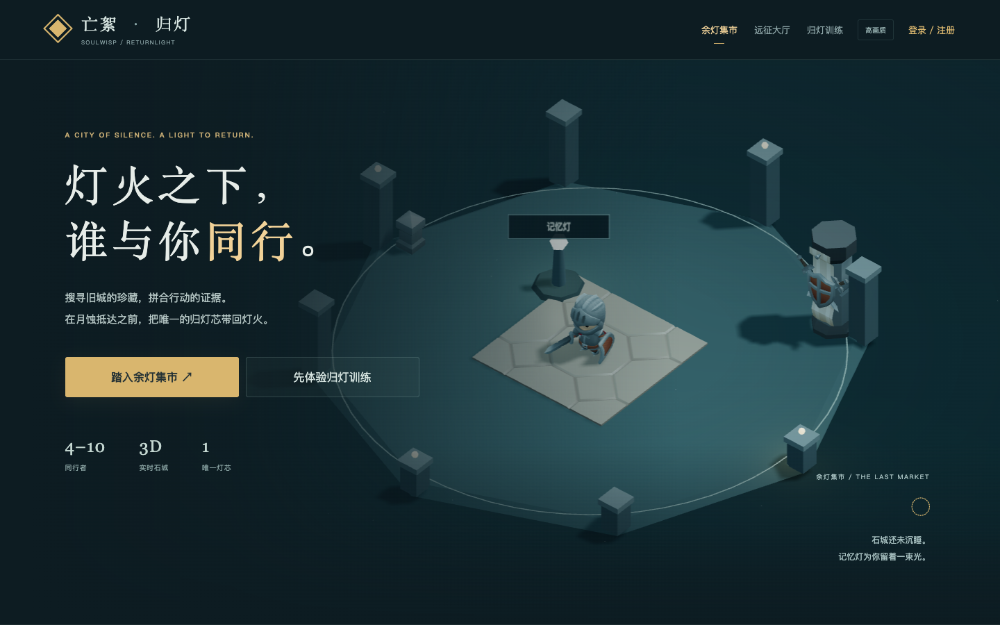
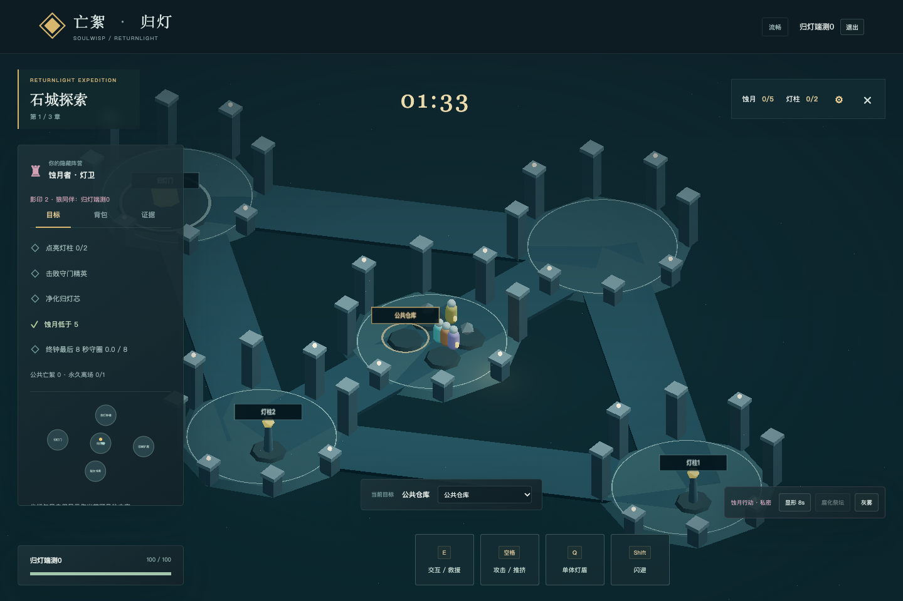
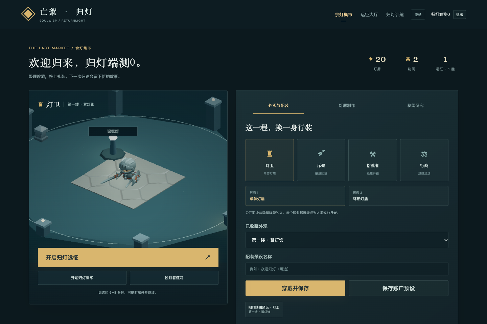

# 亡絮：归灯 · 玩家手册

截图来自历史版本，当前界面可能已有调整；见 [截图说明](screenshots/README.md)。

## 第一次进入

打开[在线游戏](https://gaming.byron.wang/)，点“踏入余灯集市”，填写昵称、邮箱和密码创建账户。账户会保存材料、收藏、外观和配装。点“开始归灯训练”，跟随艾琳留下的记忆完成六段操作；也可以先体验访客训练，再注册。

训练沿归灯堂、钟楼、矿庭、书库和城门五区展开；指引会显示当前子任务、目的地和路线。开箱、交付、寄存、点灯、降蚀、净化及守圈都要到对应站点实际操作。训练可保存离开、继续和重温。采集、工程、战斗、讨论、祝福和护送使用正式规则的交互方式；训练物资独立，重复训练不增加对局材料。

## 和朋友开一局

在营地点“开启归灯远征”，再点“加入等待区”；朋友各用独立账户加入同一个等待区。前 10 位为候选，至少 4 位且全部准备后倒数 10 秒自动出征。超过 10 人仍可入厅聊天并候场，不需要邀请码或手选人数。

在等待面板选择职业偏好，冲突由系统抽签。进入游玩区后有 45 秒查看分配的职业、选择技能形态，职业不可更换。最终结算展示 15 秒后自动回到等待区，重新排到队尾并清除准备；也可以提前返回。

秘密阵营在探索开始时分配。相同职业既可能是守灯者，也可能是蚀月者；修灯、救援和交易都不能直接证明阵营。

## 探索和交互

| 操作 | 电脑 | 手机 |
|---|---|---|
| 移动 | WASD / 方向键 | 右下方向控制 |
| 自动锁定 | 靠近物件或倒地者 | 靠近物件或倒地者 |
| 采集、工程、救援 | E / 交互按钮 | 交互按钮 |
| 攻击 / 推挤 | 空格 | 攻击按钮 |
| 职业技能 | Q | 技能按钮 |
| 闪避 | Shift | 闪避按钮 |

进入接近范围后会自动高亮，提示栏显示当前动作及缺少的条件。按 E 或触屏动作按钮执行，读条期间目标固定；移动、取消或受击会中断。攻击寻找面前的守卫或玩家，闪避沿移动方向或最后朝向执行。将采集的亡絮交到收絮匣，可以帮助全队建设归灯柱。章末未消耗的已释放工程亡絮统一进入公共仓库。

守灯者有两条胜利路线：通过证据表决封印全部蚀月者，或者完成归灯工程、击败精英、净化唯一归灯芯并护送撤离。最后八秒需持续满足守圈条件。胜负在固定终局判定；被封印后仍可通过回响文字、有限遗票和引路参与。

背包空间有限。旧城珍藏可以丢弃或提出交接，对方接受后才转移。携带归灯芯会占两格；靠近同行者后，可在背包中提出交接；双方确认后才转移。

## 议会、证据和表决

探索时查阅自己的亲历记录；进入议会后打开“证据”，选择记录发布到证据板。议会先逐席陈述，再自由讨论；点“连接议会语音”并授权麦克风，到自己的发言轮再开启麦克风。语音不可用时直接使用文字。

投票需要严格超过有权者的一半，弃权计入分母，提交后不可改票。首章只产生有限监视；后续封印额度按人数配置。不要只追逐嫌疑，归灯工程也需要人手。

## 设置你的归灯体验

点导航栏“设置”或远征右上齿轮，打开统一设置界面。

- **用户设置**：修改 2–20 字的用户名，选择归灯头像或名字头像，点“保存用户资料”。资料随账户同步，进行中的远征和通话下次加入时使用新名字。
- **画面设置**：选择自动、高画质、均衡或流畅；帧率上限可以跟随屏幕刷新率，或限制为 60 / 120 FPS。
- **音频设置**：选择麦克风与音响 / 耳机，调整语音收听音量。设备名称不完整时点“授权并刷新设备”，刷新后关闭麦克风。开麦仍由通话按钮控制。浏览器不支持输出选择时，在系统声音设置中切换。
- **声音和交互反馈**：分别调整背景音乐、音效，开关游戏声音、设备震动和减少动态效果。

画面、音频和反馈偏好自动保存在当前浏览器。打开设置会停止角色移动输入；远征仍继续计时。

首次点击或按键后启用配乐；集市、制作、研究、训练各课及远征各阶段拥有不同BGM，切换时淡入淡出。公共语音及议会期间音乐会自动降低音量，切到其他标签页后暂停。挥击有即时破风声；命中、格挡、受伤、碰撞、拾取和工程完成使用服务端确认反馈。支持震动的手机浏览器会输出不同触感节奏。

页面固定适应窗口大小。营地工坊、席位列表、聊天、证据和弹窗内容过长时，在组件内滚动；页头和游戏操作不会随整页滚走。组件滚动条预留固定宽度，出现或隐藏不挤动文字和按钮。

默认自动画质：性能足够时保持最高画质，持续掉帧时先减少阴影和装饰，再降低分辨率。在“设置 → 画面设置”也可切到高画质、均衡或流畅。减少动态效果保留危险提示与命中信息。

## 结算后制作与换装

返回营地，打开“灯屑制作”，用有效对局奖励制作装饰、职业礼装或摆件。打开“秘闻研究”收藏研究蓝图及对应配色；标准对局的允许技能池对所有账户开放。

在“外观与职业偏好”选择已收藏外观、职业与技能形态，点“穿戴并保存”。填写预设名称，点“保存账户预设”，以后可以再次加载。首局即可制作“第一缕·絮灯饰”；下一局以保存职业作为默认偏好；获得其他职业时使用基础外观。

等待区的候场、准备、收听和开麦见 [语音大厅](voice-lobby.md)。

刷新后可以恢复短断线席位。连续断线恢复窗口为真实六十秒；超时对局无效，不产生新增奖励。

移动方向跟随画面：W 向上、S 向下，A / D 向左 / 右，触屏方向按钮相同。连接道路轻轻导向，转向即可离开；进入区域后自由走动。角色头顶的五瓣心灯每瓣代表 20 点生命，受伤会熄灭，危险时闪动；倒地后靠近同行者按 E 救援。
